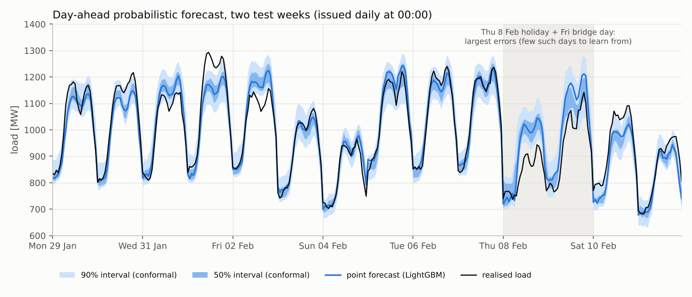
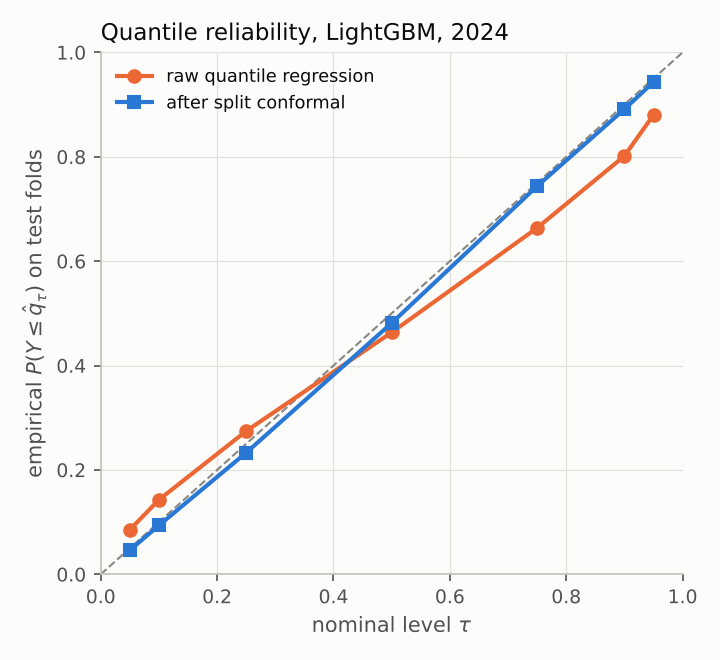
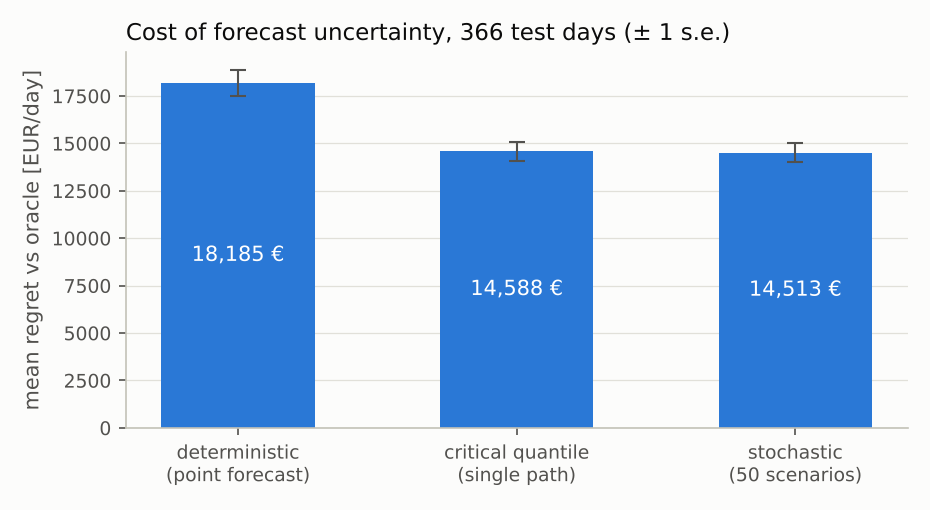

# forecast-optimize

**Predict, then optimise: probabilistic day-ahead electricity-load forecasts
fed into a two-stage stochastic procurement and battery-dispatch MILP, served
over a REST API and stored in SQL.**

[](.github/workflows/ci.yml)
· Python 3.11+ · LightGBM · HiGHS · FastAPI · SQLite / PostgreSQL · MIT

A utility or supplier has to commit **before** the delivery day: how much
energy to buy on the day-ahead market, which capacity to nominate, and how to
schedule its storage. The load it will actually serve is only known
afterwards, and every MWh of mismatch is settled at a penalty. A point
forecast answers the wrong question for this decision. The right input is the
*predictive distribution*, and the right quantity to look at is the *expected
cost of the decision*, not the MAPE.

This repository is a compact, end-to-end, fully reproducible implementation
of that loop:

```
synthetic hourly load ─► features (no leakage) ─► LightGBM quantile regression ─► split-conformal calibration
   (SI holidays, weather,                         + baselines                      (coverage reported)
    heteroskedastic noise)                                                                │
                                                                                          ▼
REST API (/forecast, /plan)  ◄──  two-stage stochastic MILP (HiGHS)  ◄──  joint scenarios (Gaussian copula)
SQLite / PostgreSQL store          deterministic | critical quantile | stochastic | oracle
```

| | |
|---|---|
|  |  |

---

## Contents

1. [Results at a glance](#1-results-at-a-glance)
2. [Data](#2-data)
3. [Forecasting](#3-forecasting): information set, models, pinball loss, conformal calibration, scenarios
4. [Optimisation](#4-optimisation): the MILP, the newsvendor quantile, value of the stochastic solution
5. [Serving and storage](#5-serving-and-storage): REST API, SQL schema, migrations, SQL optimisation
6. [How to run](#6-how-to-run)
7. [Repository layout](#7-repository-layout)
8. [Limitations and next steps](#8-limitations-and-next-steps)
9. [How AI tools were used](#9-how-ai-tools-were-used)

---

## 1. Results at a glance

The tables are produced by `python -m forecast_optimize experiment`, which
writes `results/metrics.json`; `python -m forecast_optimize tables` prints them
again. No number below was typed by hand. Full pipeline runtime: about 1 minute
on one CPU core.

**Forecasting.** Rolling-origin back-test over all of 2024: 6 folds × 61 days =
8 784 test hours. Before each origin the model is refit on all earlier data and
recalibrated on the 112 days just before the origin.

| model | MAE [MW] | RMSE [MW] | MAPE [%] | pinball raw | pinball conformal | 90% cov. raw | 90% cov. conformal | 90% width [MW] | 80% cov. conformal |
|---|---:|---:|---:|---:|---:|---:|---:|---:|---:|
| seasonal_naive | 49.5 | 76.6 | 5.47 | 16.14 | 16.34 | 0.901 | 0.885 | 198.6 | 0.793 |
| fourier_linear | 27.4 | 34.7 | 2.94 | 7.90 | 8.42 | 0.895 | 0.862 | 111.1 | 0.756 |
| lightgbm | 24.5 | 32.2 | 2.63 | 7.41 | 7.21 | 0.795 | 0.897 | 106.9 | 0.797 |

("pinball" is the mean pinball loss over the 7 levels 0.05, …, 0.95, in MW.)

**Decisions.** The same 366 test days, LightGBM forecasts, and the market and
battery parameters of §4. Each plan is scored on the realised load.

| strategy | mean daily cost [EUR] | regret vs oracle [EUR/day] | mean capacity [MW] | mean solve time [s] |
|---|---:|---:|---:|---:|
| deterministic | 2,257,726 | 18,185 | 1056.9 | 0.002 |
| quantile | 2,254,129 | 14,588 | 1077.4 | 0.004 |
| stochastic | 2,254,055 | 14,513 | 1124.0 | 0.041 |
| oracle | 2,239,542 | 0 | 1068.7 | 0.003 |

* days evaluated: 366; mean realised daily peak: 1073.5 MW; solves needing the MILP fallback: 0 of 1464
* realised VSS (deterministic - stochastic): 3,671 EUR/day (standard error 526); stochastic cheaper on 59% of days
* critical-quantile path minus stochastic: 74 EUR/day (standard error 93)
* in-model VSS (EEV - RP on 1000 fresh scenarios/day): 4,820 EUR/day



**What these numbers say**

* LightGBM with lag, calendar and weather-forecast features beats the Fourier
  regression (MAE −11 %) and the seasonal naive model (−50 %). Most of the
  remaining error sits on holidays and bridge days (see the shaded days in the
  first figure): there are only about a dozen such days per year to learn from.
* **Raw quantile regression is over-confident.** Its 90 % intervals cover only
  79.5 % of test hours, because gradient-boosted quantiles fit the training
  data too closely. Split-conformal calibration brings coverage to **89.7 %**,
  with intervals that are still the narrowest of the three models, and lowers
  the pinball loss (7.41 → 7.21).
* **Conformal calibration is not a free lunch.** For the Fourier model it
  *lowered* coverage (0.895 → 0.862), and in the July fold it reached only
  0.62. That fold's calibration window (March–June, mild weather, small
  errors) was not representative of the hot summer test block. This is the
  exchangeability assumption failing in practice; see §3.4.
* **Optimising against the distribution pays.** The stochastic plan cuts the
  regret against the perfect-foresight oracle by 3 671 EUR/day relative to
  planning on the point forecast (≈ 1.3 M EUR/year at this scale, about 7
  standard errors from zero). Almost all of that gain is already captured by
  the newsvendor insight of §4.2: planning on the *critical-ratio quantile*
  path, a single deterministic solve, is statistically indistinguishable from
  the 50-scenario program here (74 ± 93 EUR/day).
* The residual regret of ≈ 14.5 k EUR/day is the realised *value of perfect
  information* (cost of stochastic plan − cost of oracle). It is the upper
  bound on what any further forecast improvement could earn under this cost
  structure.

The data are synthetic, so the absolute EUR figures illustrate the method
and are not claims about any real portfolio.

---

## 2. Data

`forecast_optimize.data.synthetic.generate()` produces 2020–2024 hourly data
(43 848 hours) from a documented generating model, seeded and fully offline.
The full specification is in [docs/data_model.md](docs/data_model.md). In
brief:

$$
y_t = m_t + \sigma_t\eta_t,\qquad
m_t = \mu(t)\,L_d\,P_{k}(h)\,F_t\,G_t + \beta_H(T_H-\tilde T_t)_+ + \beta_C\,c(h)\,(\tilde T_t-T_C)_+ ,
$$

* **seasonality:** daily profile $P_k(h)$ for three day types (working day,
  Saturday, Sunday or holiday), weekly through the day types, annual through
  temperature and the lighting factor $G_t$;
* **calendar:** all Slovenian public holidays (Easter computed, Whit Sunday,
  the 2013–2016 rule for 2 January, the 14 August 2023 one-off), bridge days,
  and the Christmas and August holiday periods. The holiday sets were checked
  against the `holidays` package for 2005–2030;
* **weather:** temperature with annual and diurnal cycles plus persistent
  regimes, and a day-ahead *temperature forecast* with autocorrelated errors.
  Load responds to a 12-hour-smoothed temperature (thermal inertia) through a
  piecewise-linear heating/cooling degree response with a dead band at
  15–21 °C;
* **noise:** AR(1), proportional to the level, larger in extreme weather and on
  irregular days (heteroskedastic);
* day-ahead **prices** with morning and evening peaks and a midday solar dip.

The day-ahead forecast is issued at 00:00 of day $D$; the information set is
described in §3.1.

---

## 3. Forecasting

### 3.1 Information set and leakage control

A forecast for day $D$ is issued at 00:00 of $D$. It may use load and
temperature observations up to 23:00 of $D-1$, and the day-ahead temperature
forecast for $D$. Features (`features.py`):

* lags $y_{t-24}, y_{t-48}, y_{t-168}, y_{t-336}$ (hour $h$ of earlier days,
  always observed), yesterday's mean and max, the 7-day mean, and the last
  observation at 23:00;
* the temperature forecast, its 12 h and 48 h causal EWMAs, the daily mean of
  the forecast, and the change against yesterday's observed temperature;
* calendar: hour, weekday, day type, holiday, bridge day, Christmas period,
  annual Fourier terms, and the day types of the lagged days.

`tests/test_leakage.py` **destroys every value that is unknown at the issue
time** (load and temperature from $D$ on, temperature forecasts from $D+1$ on)
and asserts that (i) the feature rows of day $D$ are bit-identical, and (ii) a
fully fitted, calibrated fold produces identical day-1 forecasts. It also
checks that train, calibration and test blocks are disjoint and time-ordered
and that the test blocks tile time.

### 3.2 Models

| model | point forecast | quantiles |
|---|---|---|
| `seasonal_naive` | $y_{t-168}$ | point + empirical quantiles of training residuals |
| `fourier_linear` | OLS on 6 daily harmonics × 3 day types, 3 annual harmonics, a hinge basis in the smoothed temperature forecast (knots 6–24 °C), holiday dummies, yesterday's mean | point + residual quantiles |
| `lightgbm` | gradient boosting, L2 loss | one booster per level $\tau$ with the pinball loss, crossings removed by sorting |

### 3.3 Pinball loss and why quantile regression works

For $\tau\in(0,1)$ the pinball (check) loss is
$\rho_\tau(u) = u\,(\tau - \mathbb 1\{u<0\})$, with $u = y - q$. For any
random variable $Y$ with distribution function $F$,

$$
\frac{d}{dq}\,\mathbb E\,\rho_\tau(Y-q) = -\tau\,\mathbb P(Y>q) + (1-\tau)\,\mathbb P(Y<q) = F(q) - \tau
$$

(at continuity points of $F$). The function is convex in $q$, so it is
minimised exactly at the $\tau$-quantile. Minimising the empirical pinball loss
over a model class therefore estimates conditional quantiles. The mean pinball
loss over a grid of levels is a proper scoring rule for the whole predictive
distribution (a coarse discretisation of CRPS/2). `tests/test_models.py` checks the
minimiser numerically.

### 3.4 Split-conformal calibration

**Procedure** (`models/conformal.py`). Fit the quantile model on the training
block. On the calibration block $\{(x_i,y_i)\}_{i=1}^n$ compute the scores
$s_i = y_i - \hat q_\tau(x_i)$ and set

$$
\tilde q_\tau(x) = \hat q_\tau(x) + s_{(k)},\qquad
k = \lceil (n+1)\tau\rceil \ (\tau\ge\tfrac12),\quad k=\lfloor (n+1)\tau\rfloor\ (\tau<\tfrac12),
$$

where $s_{(k)}$ is the $k$-th smallest score, with $s_{(0)}=-\infty$ and
$s_{(n+1)}=+\infty$.

**Guarantee.** *If the $n$ calibration pairs and the test pair are
exchangeable, then $\mathbb P(Y\le\tilde q_\tau(X))\ge k/(n+1)\ge\tau$ for
$\tau\ge\frac12$, and $\mathbb P(Y<\tilde q_\tau(X))\le k/(n+1)\le\tau$ for
$\tau<\frac12$. Hence the interval $[\tilde q_{\alpha/2},\tilde
q_{1-\alpha/2}]$ has marginal coverage at least $1-\alpha$.*

*Proof sketch.* Under exchangeability the score $s_{n+1}$ of the test point is
equally likely to occupy each of the $n+1$ ranks among
$s_1,\dots,s_{n+1}$ (ties only help). The event $Y\le\tilde q_\tau(X)$, i.e.
$s_{n+1}\le s_{(k)}$, holds whenever $s_{n+1}$ is among the $k$ smallest of
all $n+1$ scores, which has probability at least $k/(n+1)$. The lower
quantile is symmetric. The two tail events have probability at most
$\alpha/2$ each, and the union bound gives the interval statement. ∎

With continuous scores the coverage is exactly $(k_{hi}-k_{lo})/(n+1)\le
1-\alpha+2/(n+1)$, so the interval is not much too wide either. A Monte Carlo
test with a deliberately biased, too-narrow base model reproduces the exact
value 0.92 for $n=49$, $\alpha=0.1$ (`test_split_conformal_marginal_coverage_under_exchangeability`).

**What the guarantee does not say.**

* It is *marginal*, averaged over $X$. It is not conditional coverage for
  cold winter evenings or holidays.
* **Hourly load is not exchangeable.** Residuals are autocorrelated (AR(0.9)
  noise, persistent weather-forecast errors) and the series is
  non-stationary (season-dependent noise level). The theorem therefore does
  **not** apply here; conformal calibration is a well-motivated recalibration
  heuristic, which is why the empirical coverage is reported on held-out folds
  rather than assumed. The bound degrades by the amount of distribution shift
  between the calibration and test blocks (Barber, Candès, Ramdas & Tibshirani,
  *Conformal prediction beyond exchangeability*, Ann. Statist. 2023), and the
  Fourier July fold above shows the effect. Adaptive conformal inference
  (Gibbs & Candès, NeurIPS 2021), which updates $\alpha$ online, would be the
  next step.
* The calibration block has $n = 112\cdot24 = 2688$ hours, but because of the
  dependence the effective sample size is much smaller.

### 3.5 From marginals to joint scenarios

The optimisation has a **daily-peak** term, and the distribution of
$\max_t Y_t$ depends on how the 24 hours move together. Scenarios are drawn
from a **Gaussian copula** (`models/copula.py`):

1. The calibrated quantiles $q_{t,\tau_1}<\dots<q_{t,\tau_7}$ define an
   inverse CDF by linear interpolation in the normal score $z=\Phi^{-1}(\tau)$,
   extrapolated linearly in the tails. This reproduces a Gaussian marginal
   exactly (tested).
2. The PIT values of the calibration days are mapped to normal scores
   $z_{d,h}$. Their 24×24 correlation matrix $R$ is estimated and shrunk 5 %
   towards $I$.
3. Draw $Z\sim N(0,R)$ and set $y_{t}=F_t^{-1}(\Phi(Z_t))$.

---

## 4. Optimisation

### 4.1 The day-ahead problem (`optimize/dayahead.py`)

**First stage**, decided before day $D$: energy bought day-ahead
$x_t\ge0$ at price $\pi_t$; a nominated capacity $C\ge0$ at cost $k$ per MW;
battery charge $c_t$, discharge $d_t$, state of charge $e_t$, and a binary
$z_t$.
**Second stage**, after the load $y$ is realised: shortfall $u_t$ bought at
$\pi_t+\lambda^+$, surplus $v_t$ sold at $\pi_t-\lambda^-$, and peak exceedance
$g$ above $C$ charged $p^{ex}$ per MW. With scenarios $y^1,\dots,y^S$ and
weights $w_s$:

$$
\begin{aligned}
\min\quad & \sum_t \pi_t x_t + kC + \delta\sum_t (c_t+d_t)
   + \sum_s w_s\Big[\sum_t\big((\pi_t+\lambda^+)u_{st} - (\pi_t-\lambda^-)v_{st}\big) + p^{ex} g_s\Big]\\
\text{s.t.}\quad & x_t + d_t - c_t + u_{st} - v_{st} = y_{st} && \text{(energy balance)}\\
& y_{st} - d_t + c_t - C \le g_s && \text{(peak above nomination)}\\
& e_{t+1} = e_t + \eta_c c_t - d_t/\eta_d,\quad e_0 = e_{24} = e_{\text{init}},\quad 0\le e_t\le E\\
& 0\le c_t\le P z_t,\quad 0\le d_t\le P(1-z_t),\quad z_t\in\{0,1\}\\
& x,\,C,\,u,\,v,\,g\ \ge 0 .
\end{aligned}
$$

Default parameters: $\lambda^+=40$, $\lambda^-=15$ EUR/MWh, $k=4$ EUR/MW/day,
$p^{ex}=60$ EUR/MW, a 100 MWh / 25 MW battery with 95 % one-way efficiency
and $\delta=2$ EUR/MWh throughput cost. The problem has $O(24S)$ variables
and rows and is assembled as a sparse matrix and passed directly to HiGHS
(`highspy`).

* **deterministic:** $S=1$, the scenario is the point (conditional-mean)
  forecast.
* **quantile:** $S=1$, the scenario is the hourly $\tau^*$-quantile path (§4.2).
* **stochastic:** $S=50$ copula scenarios (sample average approximation).
* **oracle:** $S=1$, the scenario is the realised load (perfect foresight;
  not implementable).

Every plan is then scored on the realised load with the closed-form optimal
recourse (`realized_cost`). A test checks that this equals the solver's
objective.

**LP first, MILP only if needed.** The binaries exist only to forbid
simultaneous charging and discharging. `solve_day(mip="auto")` first solves
the LP relaxation. The relaxation's optimal value is a lower bound for the
MILP, so if its optimum already has $\min(c_t,d_t)=0$ for all $t$, it is
MILP-feasible and therefore MILP-optimal. Otherwise the MILP is solved. With
In the back-test the fallback was never needed (see the results notes), and the LP is about 10× faster than the MILP. A test
constructs negative prices, where the relaxation "burns" energy by charging
and discharging at once, and checks that the fallback triggers.

### 4.2 Why the critical quantile $\tau^*=\lambda^+/(\lambda^++\lambda^-)$ appears

Take a single hour with no battery and no capacity term. Buying $x$ when the
load turns out to be $Y$ costs

$$
c(x,Y) = \pi x + (\pi+\lambda^+)(Y-x)_+ - (\pi-\lambda^-)(x-Y)_+ .
$$

Using $(Y-x)_+ - (x-Y)_+ = Y-x$,

$$
c(x,Y) = \pi Y + \lambda^+(Y-x)_+ + \lambda^-(x-Y)_+
       = \pi Y + (\lambda^++\lambda^-)\,\rho_{\tau^*}(Y-x),\qquad \tau^*=\frac{\lambda^+}{\lambda^++\lambda^-}.
$$

The price cancels, because energy has to be paid for either way, and **the
expected cost is, up to a constant, the expected pinball loss at level
$\tau^*$**. By §3.3 the optimal purchase is the $\tau^*$-quantile of the
predictive distribution, which is the classical newsvendor solution
$F(x^*)=\lambda^+/(\lambda^++\lambda^-)$. With the defaults
$\tau^*=40/55\approx0.727$: under-buying costs more than over-buying, so the
optimal plan buys above the median. For the sample average over $S$ equally
weighted scenarios the minimiser is the $\lceil S\tau^*\rceil$-th order
statistic (unique when $S\tau^*\notin\mathbb Z$).

In the same way, with no battery the capacity term
$kC+p^{ex}\,\mathbb E(\max_tY_t-C)_+$ is minimised by the
$(1-k/p^{ex}) = 0.933$-quantile of the **daily peak**. This is a quantile of
a maximum, so it needs the joint distribution, which is what the copula
provides.

Verified numerically in `tests/test_optimize.py`. The full MILP (battery
disabled) returns exactly the $\lceil S\tau^*\rceil$-th order statistic of the
scenarios for every hour and the $\lceil S(1-k/p^{ex})\rceil$-th order
statistic of the scenario peaks for $C$. With 4 000 Gaussian scenarios it
recovers $\mu+\sigma\Phi^{-1}(\tau^*)$ for three different $(\lambda^+,\lambda^-)$.

This explains the results table. The "quantile" strategy is exactly optimal
for the energy part, which is separable across hours. It differs from the
full stochastic program only in the capacity nomination (roughly the peak of the $\tau^*$ path,
$\max_t q_{t,\tau^*}$, instead of the 0.933-quantile of the daily peak) and in how
the battery hedges. Those terms are small here, so the two strategies tie.

### 4.3 Value of the stochastic solution

In Birge's notation, $\mathrm{VSS} = \mathrm{EEV} - \mathrm{RP}$: the expected
cost of the plan built on the expected-value scenario (here the point forecast,
an estimate of the conditional mean), minus the optimal value of the
stochastic program. Two estimates are reported:

* **in-model**, 4 820 EUR/day: both plans are evaluated on 1 000 *fresh*
  scenarios from the predictive distribution. The SAA plan's out-of-sample cost
  is an upper estimate of RP, so this VSS estimate is conservative under the
  model;
* **realised**, 3 671 ± 526 EUR/day: both plans are evaluated on the actual
  2024 load. This is what the business would see. It is lower than the
  in-model figure, plausibly because the predictive distribution is not
  perfectly calibrated.

---

## 5. Serving and storage

### 5.1 REST API (`api/`)

```bash
python -m forecast_optimize serve            # http://127.0.0.1:8000/docs (OpenAPI / Swagger UI)
curl -s -X POST localhost:8000/forecast -H 'content-type: application/json' \
     -d '{"date": "2024-08-14", "persist": true}'
curl -s -X POST localhost:8000/plan -H 'content-type: application/json' \
     -d '{"date": "2024-08-14", "strategy": "stochastic", "n_scenarios": 50,
          "market": {"lambda_up": 40, "lambda_down": 15, "battery": {"energy_mwh": 100, "power_mw": 25}}}'
```

| endpoint | does |
|---|---|
| `GET /health` | model name, training cutoff, last available day |
| `POST /forecast` | 24 hourly point forecasts + 7 conformal quantiles; optionally persisted (`run_id`) |
| `POST /plan` | hourly purchase, battery schedule and capacity for a strategy and market parameters |

Request and response bodies are pydantic models (`api/schemas.py`), so
validation errors return 422 and the OpenAPI schema is generated
automatically. The service refuses dates before its training cutoff, since
those would be in-sample. `create_app(service, db)` takes its dependencies
as arguments, so the tests inject a small, fast model and an in-memory
database (`tests/test_api.py`, FastAPI `TestClient`).

### 5.2 Database (`storage/`)

* `FO_DATABASE_URL` unset → SQLite file `data/forecast_optimize.db` (stdlib
  `sqlite3`, the tested default); `sqlite:///:memory:` for tests;
  `postgresql://…` → PostgreSQL through `psycopg` (`pip install -e ".[postgres]"`).
* **Migrations are plain SQL** in `storage/migrations/{sqlite,postgres}/NNN_name.sql`.
  `Database.migrate()` applies the missing ones in order, each atomically,
  and records them in `schema_migrations`.
* Tables: `measurements`, `forecast_runs`, `forecast_values` (one row per run ×
  target hour × quantile, with `horizon_h`) and `forecast_points`. Upserts use
  `ON CONFLICT … DO UPDATE`.
* The PostgreSQL path was tested against a local PostgreSQL 16
  (`FO_TEST_POSTGRES_URL=… pytest tests/test_storage.py`), and CI runs it in a
  `postgres:16` service container.

### 5.3 SQL optimisation study

`scripts/sql_benchmark.py` builds about 1 M forecast rows and times typical
queries before and after the read-path index of migration 002. Full write-up
in **[docs/sql_optimization.md](docs/sql_optimization.md)**; raw timings and
every query plan are in [docs/sql_benchmark_results.md](docs/sql_benchmark_results.md).
Highlights (SQLite):

| query | slow form | fast form |
|---|---:|---:|
| latest forecast per hour, 30 days | correlated subquery, no index: 28.5 s | covering index + aggregate/join: 1.4 ms |
| one day of forecasts | `date(target_ts) = …`: 17.3 ms | half-open range on raw column: 0.12 ms |
| rolling 7-day MAE | correlated subquery: 940 ms | window function `ROWS BETWEEN 167 PRECEDING`: 18 ms |

The study also found an engine difference. Restating the range predicate on
the joined table cut PostgreSQL's time for the latest-forecast join from 61 ms
to 3.6 ms, while SQLite was already fast without it.

---

## 6. How to run

```bash
git clone https://github.com/urbanog/forecast-optimize && cd forecast-optimize
python -m venv .venv && source .venv/bin/activate
pip install -e ".[dev]"            # add ,postgres for PostgreSQL support

make lint                          # ruff check + format check
make test                          # 47 tests (1 PostgreSQL test skipped without FO_TEST_POSTGRES_URL), ~25 s
make experiment                    # back-test + decisions -> results/, docs/figures/ (~1 min)
make tables                        # print the README tables from results/metrics.json
make sql-bench                     # SQL study -> docs/sql_benchmark_results.md (~40 s)
make serve                         # REST API on :8000

python -m forecast_optimize generate --out data/synthetic_load.csv   # export the data set
python -m forecast_optimize ingest                                    # migrate + load into the DB
python -m forecast_optimize plan --date 2024-08-14 --strategy stochastic
```

Everything runs offline, and all randomness is seeded.

---

## 7. Repository layout

```
src/forecast_optimize/
  calendar_si.py          Slovenian holidays, Easter, day types, bridge days
  data/synthetic.py       seeded data-generating process (docs/data_model.md)
  features.py             leakage-safe features; Fourier/hinge design matrix
  metrics.py              MAE, RMSE, MAPE, pinball
  models/forecasters.py   seasonal naive, Fourier OLS, LightGBM quantiles
  models/conformal.py     split-conformal quantile calibration
  models/copula.py        quantile curves <-> normal scores, Gaussian copula scenarios
  models/cv.py            rolling-origin folds, fit/calibrate/predict, scoring
  optimize/dayahead.py    two-stage MILP (HiGHS), closed-form recourse cost
  pipeline.py             strategies, decision back-test, ForecastService
  api/                    FastAPI app + pydantic schemas
  storage/                DB layer + SQL migrations (sqlite/, postgres/)
  experiment.py, plots.py, __main__.py (CLI)
scripts/sql_benchmark.py  SQL optimisation study
tests/                    unit, leakage, math (newsvendor, conformal), API, storage, end-to-end
docs/                     data model, SQL study, figures
.github/workflows/ci.yml  ruff + pytest (Python 3.11 and 3.13) + PostgreSQL job
```

---

## 8. Limitations and next steps

* **Synthetic data.** The generator is realistic in structure, not
  calibrated to a real network. Its noise is Gaussian AR(1), so heavy tails,
  outages, structural breaks and behind-the-meter PV are absent. Next: a
  loader for ENTSO-E / ELES load data (`generate()` returns the same columns
  a CSV loader would).
* **Issue time.** Forecasts are issued at 00:00 of $D$; real day-ahead bids
  close around noon of $D-1$. That adds 12–35 hours of horizon and removes
  the most recent lags. The feature code is written around the issue time,
  so the change is a shift of lags, not a redesign.
* **Prices are treated as known** when planning (a price-taker with a perfect
  price forecast). A joint load-price scenario model is the natural
  extension.
* **Conformal under dependence** (§3.4). Coverage is approximate, and
  seasonality in the noise level breaks it in some folds. Next: conditional
  calibration by season or hour, or adaptive conformal inference.
* **Model selection.** The LightGBM settings (200 trees, learning rate 0.1)
  and the 112-day calibration window were picked after comparing a few
  alternatives on this same 2024 period. The differences were small (MAE
  24.5 vs 24.5; 90 % coverage 0.88–0.90), but strictly speaking such choices
  belong on a separate validation year.
* **Scenario count.** 50 scenarios were not tuned. The SAA optimality gap
  could be bounded with the usual multiple-replication procedure.
* **DST** is ignored (every day has 24 hours); production code should store
  UTC.

---

## 9. How AI tools were used

This project was developed with the help of an AI coding assistant (Claude,
by Anthropic). It drafted much of the code, the tests and this README from
my specification. I reviewed the design, the mathematics (the newsvendor
derivation, the conformal statement and its exchangeability caveat, the LP
relaxation argument) and the results. Every number in this README is
produced by the scripts in the repository and can be regenerated with
`make experiment` and `make sql-bench`.

---

© 2026 Urban Ogrinec · [MIT License](LICENSE)
